# Introdução

Este repositório tem a minha atividade de **Teste Caixa Cinza com Supabase e Postman**, da matéria de UX/UI e Testes de Software.

| | |
|---|---|
| **Aluno** | Matheus Bau Nardi |
| **Curso** | Análise e Desenvolvimento de Sistemas |
| **Turma** | AS406TSN4 |
| **GitHub** | [Matheusnardi10](https://github.com/Matheusnardi10) |
| **Data dos testes** | 01/11/2026 |

Na prática, eu criei um sistema de login por e-mail e senha no Supabase e testei ele pelo Postman, sem fazer nenhuma tela. A ideia era ver se a API autentica quando deve e recusa quando deve. Tudo o que fiz está documentado aqui no README, e os prints são das minhas próprias execuções.

### Estrutura do repositório

```
/README.md
/postman/    -> collection e environment exportados do Postman
/prints/     -> evidências (prints) de cada etapa
/planilha/   -> planilha de registro dos testes
```

---

# Objetivo da Atividade

O objetivo era aprender a fazer testes de caixa cinza em uma API de autenticação. Caixa cinza quer dizer que eu sei algumas coisas de como a API funciona (o endereço dela, os headers, o formato do JSON e o que ela responde), mas não vejo o código por dentro.

Durante a atividade foram realizados:

- configuração de um ambiente de autenticação no Supabase;
- criação de um usuário válido para testes;
- configuração do Postman (workspace, environment e variáveis);
- criação de requisições HTTP e execução de 5 cenários de teste;
- validação de status HTTP, respostas JSON, mensagens de erro e access token;
- registro dos testes em planilha e documentação técnica neste README.

---

# Configuração do Supabase

### Como o projeto foi criado

1. Criei uma conta no [Supabase](https://supabase.com) entrando com a minha conta do GitHub.
2. Como a conta era nova, criei primeiro uma organização (plano **Free**, tipo pessoal) com o nome **Matheus Nardi**.
3. Dentro dela, criei o projeto **`caixa-cinza-auth`**, na região *Americas* (servidor `us-east-1`), mantendo as opções de segurança no padrão.
4. Ao final da criação, o painel mostrou o status **Healthy**.

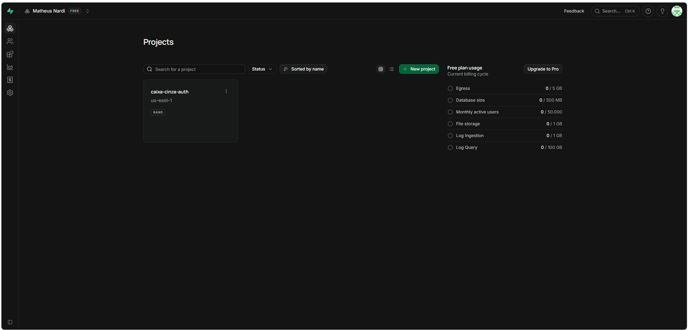

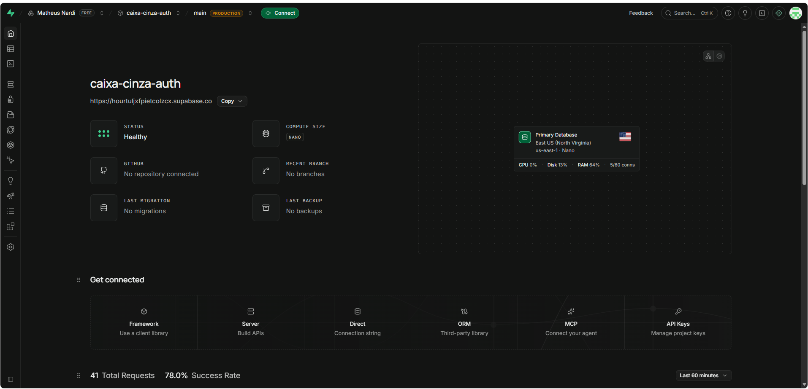

### Tipo de autenticação

Usei autenticação por **e-mail e senha**. Em **Authentication → Sign In / Providers**, o provider **Email** está **Enabled**.

Deixei o **Confirm email desligado** de propósito: com ele ligado, o usuário só consegue logar depois de confirmar o e-mail, e eu ia precisar de um e-mail real com acesso à caixa de entrada. Desligando, o usuário de teste já nasce confirmado e eu consigo usar um e-mail fictício só para testar.

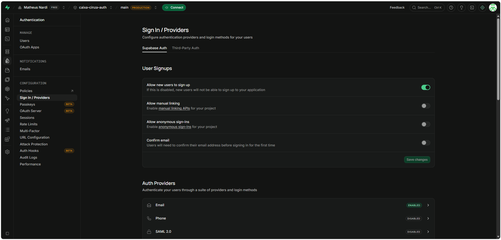

### Como o usuário foi criado

Em **Authentication → Users → Add user → Create new user**, cadastrei o usuário de teste `matheusnardi.teste@email.com`, com a opção de confirmação automática. A senha não é exibida neste documento por segurança.

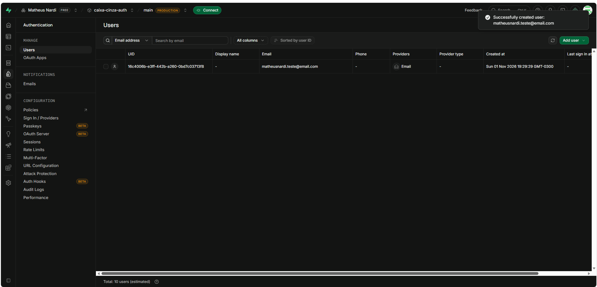

### Credenciais da API

Em **Project Settings → API Keys** obtive a **Project URL** e a chave **anon public**, necessárias para as requisições. As chaves foram ocultadas nos prints e substituídas por `XXXXX` neste documento.

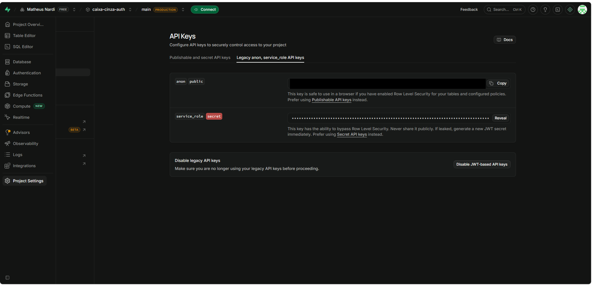

### Objetivo da configuração

Ter uma API de autenticação real, com um usuário cadastrado, para que o endpoint de login pudesse ser testado com credenciais válidas e inválidas.

> **Identificação do aluno:** o nome *Matheus Nardi* (organização) e o projeto *caixa-cinza-auth* aparecem no topo dos prints do painel.

---

# Configuração do Postman

### Workspace

Instalei o **Postman Desktop** e criei um workspace em branco chamado **Caixa Cinza Supabase**, com visibilidade pessoal.

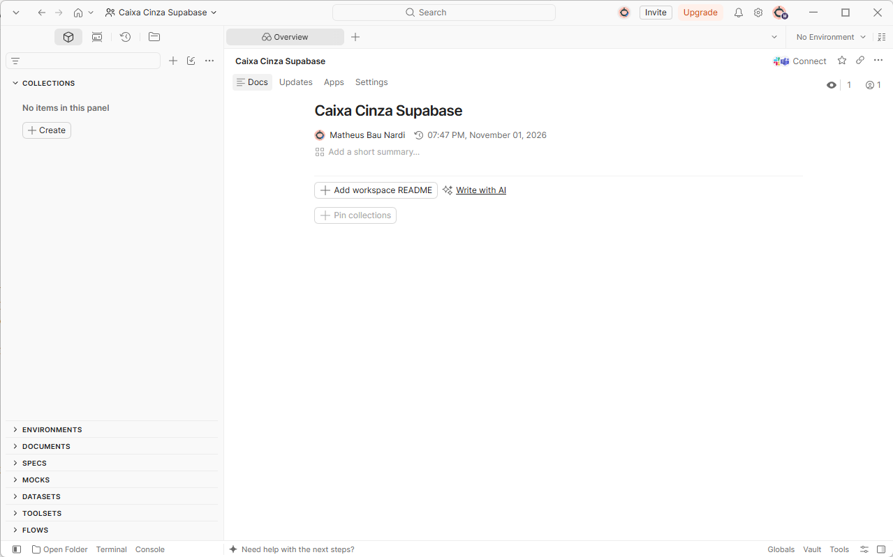

### Environment

Coloquei tudo em variáveis para não ter que digitar a URL, a chave e a senha em cada requisição. A `api_key` e a `password` eu marquei como *secret*, para elas não aparecerem nos prints nem irem para o GitHub.

| Variável | Descrição |
|---|---|
| `base_url` | URL do projeto no Supabase (`https://XXXXX.supabase.co`) |
| `api_key` | Chave pública (anon) do projeto. Marcada como *secret* |
| `email` | E-mail do usuário criado para os testes |
| `password` | Senha do usuário de teste. Marcada como *secret* |
| `access_token` | Preenchida automaticamente pelo script do login válido |

Nas requisições eu uso `{{base_url}}`, `{{api_key}}`, `{{email}}` e `{{password}}`, em vez dos valores reais.

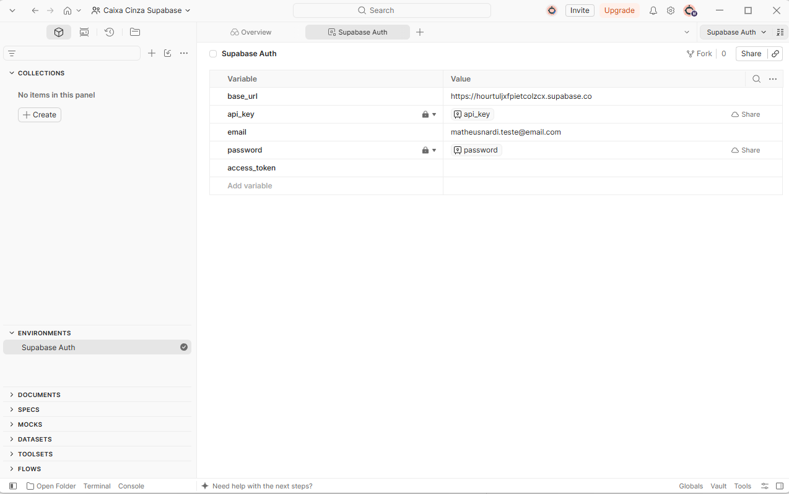

### Como o Postman foi utilizado

Criei uma collection chamada **Testes Caixa Cinza - Auth Supabase**, com uma requisição por cenário. Cada requisição envia o login ao Supabase e, na aba **Scripts** (*After response*), tem testes automáticos (`pm.test`) que validam o status e a resposta. Os resultados foram executados individualmente e também em conjunto, pelo **Runner**.


---

# Configuração das Requisições

| Item | Valor |
|---|---|
| **Endpoint** | `/auth/v1/token?grant_type=password` |
| **URL completa** | `{{base_url}}/auth/v1/token?grant_type=password` |
| **Método HTTP** | `POST` |
| **Body** | `raw` / `JSON` |

**Finalidade:** autenticar um usuário com e-mail e senha (*password grant*). Se as credenciais forem válidas, a API retorna `200 OK` com um `access_token`. Se forem inválidas, retorna um erro `400` com uma mensagem.

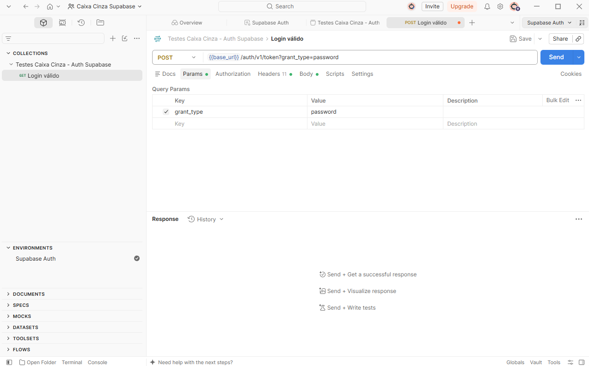

### Exemplo de Header

| Header | Valor |
|---|---|
| `apikey` | `XXXXX` |
| `Authorization` | `Bearer XXXXX` |
| `Content-Type` | `application/json` |

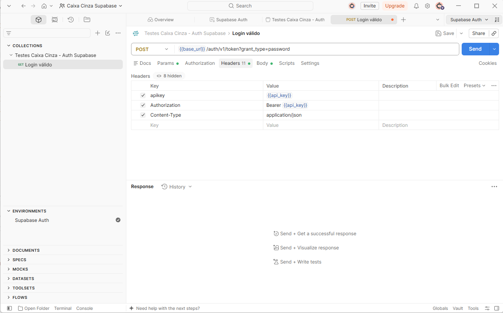

### Exemplo do Body JSON

```json
{
  "email": "usuario@email.com",
  "password": "123456"
}
```

No Postman o body usa as variáveis do environment:

```json
{
  "email": "{{email}}",
  "password": "{{password}}"
}
```

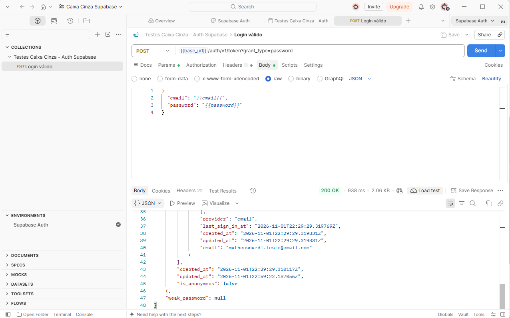

---

# Execução dos Testes

Foram executados os 5 cenários obrigatórios. Em todos, o endpoint, o método e os headers são os mesmos; só muda o conteúdo do body.

### Tabela de Cenários

| Cenário | Entrada Utilizada | Resultado Esperado | Resultado Obtido | Status |
|---|---|---|---|---|
| Login válido | E-mail e senha corretos do usuário de teste | Status 200 + access token | `200 OK`, JSON com `access_token`, `token_type: bearer`, `expires_in: 3600` e `refresh_token` | OK |
| Senha incorreta | E-mail correto e senha `SenhaErrada999` | Erro de autenticação | `400 Bad Request`, `invalid_credentials`, "Invalid login credentials" | OK |
| Usuário inexistente | E-mail `naoexiste.xyz@email.com` | Acesso negado | `400 Bad Request`, `invalid_credentials`, "Invalid login credentials" | OK |
| Campos vazios | `email: ""` e `password: ""` | Erro de validação | `400 Bad Request`, `validation_failed`, "missing email or phone" | OK |
| Credenciais inválidas | E-mail `abc@teste.com` e senha `123` | Mensagem de erro | `400 Bad Request`, `invalid_credentials`, "Invalid login credentials" | OK |

### Teste válido

O login válido retornou `200 OK`, com o `access_token` (token JWT), o `refresh_token` e os dados do usuário (`role: authenticated`, e-mail confirmado). O token foi parcialmente ocultado no print.

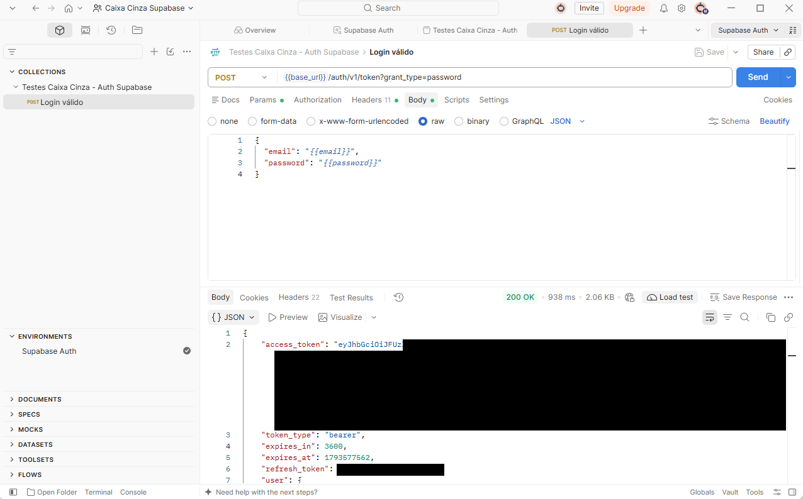

### Testes inválidos

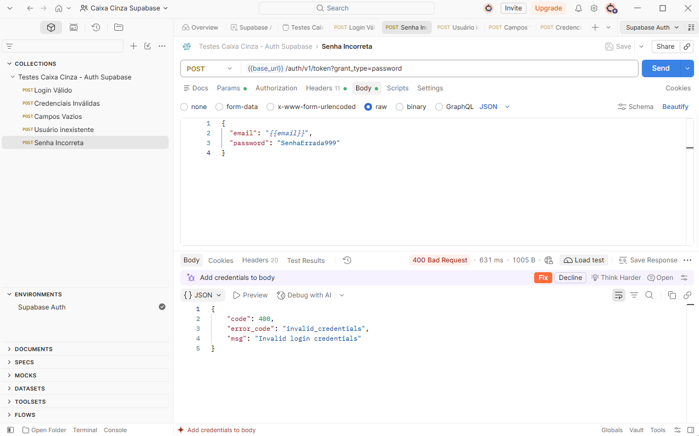

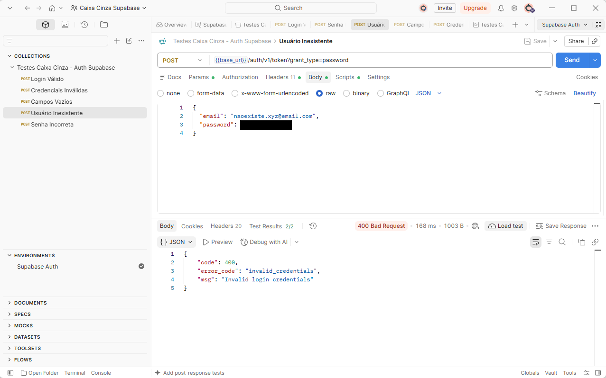

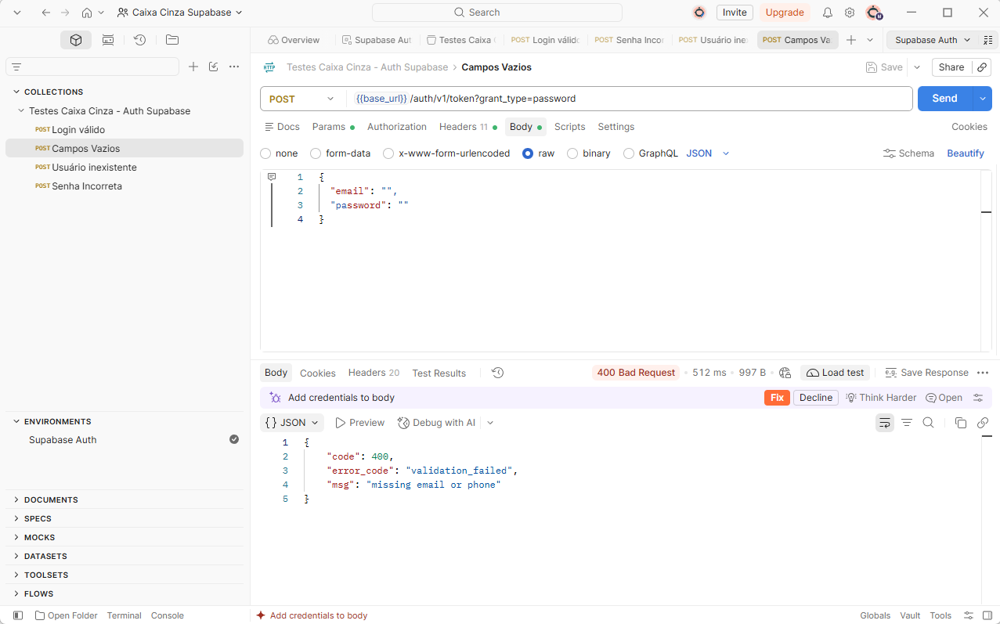


### Validações automáticas (Scripts)

Cada requisição tem testes na aba *Scripts*:

- **Login válido:** status é 200 e a resposta contém `access_token`.
- **Senha incorreta, usuário inexistente e credenciais inválidas:** status é 400 e a mensagem contém `Invalid login credentials`.
- **Campos vazios:** status é 400 e o `error_code` é `validation_failed`.

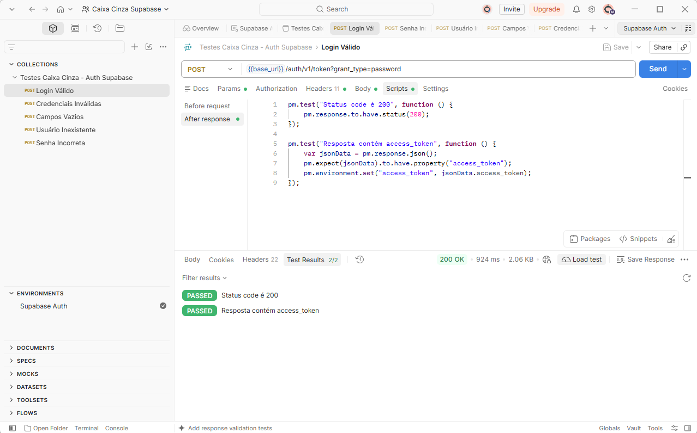

### Erros encontrados durante a atividade

Nenhum cenário deu resultado diferente do esperado. Os problemas que tive foram mais de configuração:

- **Headers no lugar errado.** Na primeira vez, preenchi `apikey`, `Authorization` e `Content-Type` na aba **Params** em vez da aba **Headers**. Com isso eles viraram parâmetros na URL e a requisição não funcionou. Percebi olhando a URL, que estava enorme, e depois de mover para a aba certa o login deu 200.
- **Qual chave usar.** No painel do Supabase aparecem a chave `anon` e a `publishable`. Usei a `anon`, porque ela serve tanto no header `apikey` quanto no `Authorization`.
- **Sugestões do Postman.** Nas respostas de erro, o Postman ficava sugerindo "Fix" para corrigir a requisição. Ignorei, porque o erro era justamente o resultado que eu queria testar.

---

# Registro dos Testes

### Como os testes foram registrados

Os testes foram registrados em uma planilha Excel, em [`planilha/planilha_testes_caixa_cinza.xlsx`](planilha/planilha_testes_caixa_cinza.xlsx), com as colunas: **ID do teste, Cenário, Entrada, Resultado esperado, Resultado obtido, Status e Observações**. Há também uma aba com as informações do projeto (responsável, data, ambiente e endpoint).

### Importância da documentação dos testes

Registrar os testes permite repetir os mesmos cenários depois (por exemplo, após uma alteração no sistema), comparar o resultado esperado com o obtido e provar o que foi verificado. Também ajuda outras pessoas a entender o que já foi coberto.

### Exemplos dos registros

| ID | Cenário | Entrada | Resultado esperado | Resultado obtido | Status |
|---|---|---|---|---|---|
| CT-01 | Login válido | E-mail e senha corretos | Status 200 + access token | 200 OK com `access_token` | Sucesso |
| CT-02 | Senha incorreta | E-mail correto, senha errada | Erro de autenticação | 400 `invalid_credentials` | Sucesso |
| CT-03 | Usuário inexistente | E-mail não cadastrado | Acesso negado | 400 `invalid_credentials` | Sucesso |
| CT-04 | Campos vazios | `""` e `""` | Erro de validação | 400 `validation_failed` | Sucesso |
| CT-05 | Credenciais inválidas | E-mail e senha aleatórios | Mensagem de erro | 400 `invalid_credentials` | Sucesso |

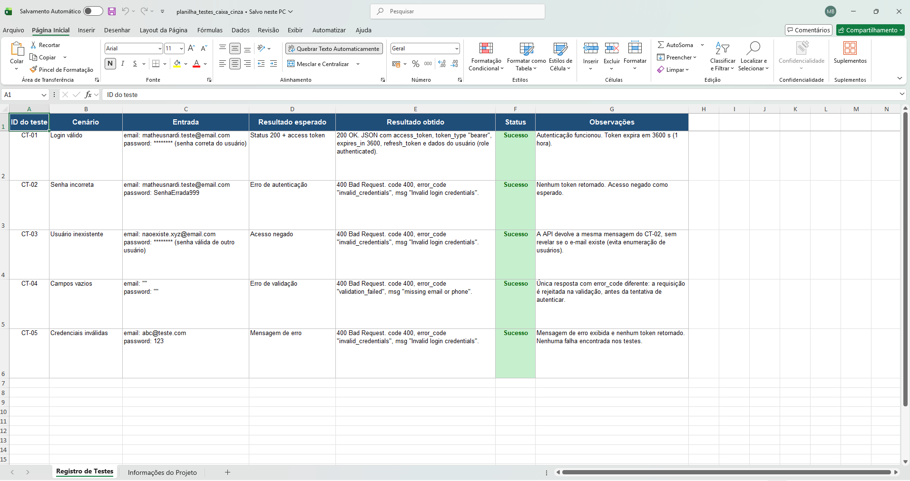

### Falhas identificadas

Nenhuma falha funcional. Uma observação: três cenários diferentes (senha incorreta, usuário inexistente e credenciais inválidas) retornam a **mesma mensagem**. Isso não é um defeito, e sim um comportamento de segurança do Supabase, que evita revelar se um e-mail está ou não cadastrado.

---

# Resultados Obtidos

Os 5 requests foram executados de uma só vez pelo **Runner** do Postman, com o environment *Supabase Auth*:

| Métrica | Resultado |
|---|---|
| Requests executados | 5 |
| Testes automáticos | 10 |
| Passaram | 10 |
| Falharam | 0 |
| Erros | 0 |
| Tempo médio de resposta | 225 ms |

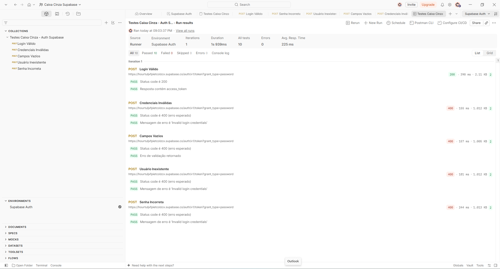

Com isso foi possível comprovar que:

- o usuário válido autentica e recebe um `access_token`;
- credenciais incorretas, de usuário inexistente ou inválidas são recusadas com status `400`;
- campos vazios são rejeitados na validação, com um erro específico (`validation_failed`);
- nenhum cenário de erro retorna token.

Os arquivos exportados do Postman estão em `/postman/`: a collection e o environment (sem as chaves e senhas, que foram removidas).

---

# Conclusão

Consegui executar todos os testes e os 5 cenários deram o resultado esperado. A autenticação funcionou: o login válido devolveu **200 OK** com o `access_token`, e todos os cenários de erro foram recusados com **400** e uma mensagem. No Runner, os 10 testes automáticos passaram.

**Dificuldades:** a que mais me atrapalhou foi o Postman no começo, quando coloquei os headers na aba errada e demorei para entender por que não funcionava. Também tive que procurar onde ficavam a URL e a chave no painel do Supabase, e tomei cuidado para não deixar chave, token e senha aparecendo nos prints, já que o repositório é público.

**Falhas:** não encontrei nenhuma falha. Uma coisa que me chamou atenção foi que senha errada, e-mail que não existe e credenciais aleatórias devolvem **a mesma mensagem** ("Invalid login credentials"). No começo achei estranho, mas entendi que é uma proteção: se a API dissesse "esse e-mail não existe", qualquer pessoa conseguiria descobrir quem tem conta.

**Melhorias:** dava para testar mais casos, como e-mail com formato inválido, senha muito curta e várias tentativas seguidas (para ver o bloqueio por excesso de tentativas). Também daria para usar o `access_token` em uma rota protegida e rodar a collection automaticamente com o Newman.

**Por que o teste caixa cinza é útil:** como eu já sei o endpoint, os headers e o formato das respostas, consigo montar cenários bem direcionados e validar a autenticação sem precisar mexer no código nem ter uma tela pronta. Dá para achar problema de login bem antes de o sistema ficar pronto.
